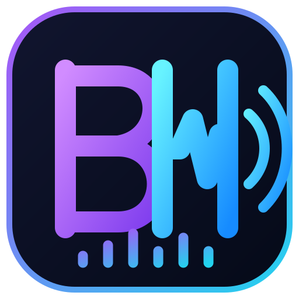

# BH VoiceDub — Android Live Dubbing

**دوبله و ترجمهٔ زندهٔ صدای رسانه در اندروید**

Maintained and customized by **BH**, based on [Doble Parsi Mobile](https://github.com/QW-AI-Code/Doble-Parsi-Mobile) by [QW-AI-Code](https://github.com/QW-AI-Code).

---

## وضعیت پروژه

BH VoiceDub نسخهٔ سفارشی اندرویدی پروژهٔ اصلی است. این نسخه شامل هویت بصری BH، آیکون اختصاصی، رنگ‌بندی بنفش/فیروزه‌ای، نام‌گذاری خروجی‌ها در پوشهٔ `Download/BH VoiceDub` و تنظیمات انتشار APK است.

**توجه:** تغییر برند به معنی بازنویسی موتور دوبله نیست. موتور فعلی همچنان به سرویس Gemini Live و اینترنت نیاز دارد؛ پردازش کاملاً آفلاین در این نسخه ارائه نمی‌شود.

## قابلیت‌های فعلی

- دریافت صدای رسانهٔ درحال‌پخش با API ضبط پخش اندروید، در برنامه‌هایی که اجازهٔ ضبط می‌دهند.
- ارسال صدا به سرویس Gemini Live برای ترجمه/دوبلهٔ زنده.
- پخش صدای دوبله و نمایش متن زنده.
- ذخیرهٔ خروجی صوتی M4A و زیرنویس SRT، در صورت فعال‌بودن گزینه‌ها.
- کنترل جلسه از اعلان و دکمهٔ شناور (در صورت فعال‌سازی مجوز مربوط).
- ذخیرهٔ خروجی‌ها در `Download/BH VoiceDub/<session>/`.

## محدودیت‌های مهم اندروید

- حداقل نسخهٔ سیستم‌عامل: Android 10 (API 29).
- ضبط صدای داخلی فقط برای محتوایی ممکن است که برنامهٔ پخش‌کننده و سیاست‌های اندروید اجازه دهند.
- بعضی برنامه‌ها و محتوای دارای DRM ضبط را مسدود می‌کنند.
- صدای تماس‌های تلفنی و تماس‌های صوتی/تصویری برنامه‌ها از مسیر ضبط رسانه قابل دریافت نیست.
- کاهش صدای اصلی در همهٔ گوشی‌ها و برنامه‌ها تضمین‌شده نیست؛ رفتار Audio Focus به نسخهٔ اندروید و سازندهٔ گوشی وابسته است.
- برای دوبلهٔ زنده اتصال اینترنت و کلید API معتبر Gemini لازم است. هزینه و محدودیت سهمیه تابع حساب و سرویس Google است.

## شروع استفاده

1. APK را از بخش [Releases](../../releases) دریافت و نصب کنید.
2. کلید API خود را از [Google AI Studio](https://aistudio.google.com/apikey) تهیه کنید.
3. کلید را داخل برنامه وارد کنید.
4. زبان مقصد و گزینه‌های پخش/ذخیره را تنظیم کنید.
5. «شروع دوبله» را بزنید و مجوزهای اندروید را فقط در صورت نیاز تأیید کنید.
6. یک رسانهٔ سازگار را پخش کنید. اگر برنامهٔ مبدأ ضبط صدا را مسدود کند، دوبلهٔ زنده از آن منبع ممکن نیست.

## ساخت APK

ساخت خودکار از طریق GitHub Actions در فایل `.github/workflows/android.yml` تعریف شده است. برای اجرای ساخت، از تب **Actions** مخزن استفاده کنید. خروجی موفق به‌صورت Artifact در همان اجرای Workflow قرار می‌گیرد.

برای انتشار قابل‌به‌روزرسانی، باید کلید امضای شخصی و Secrets مربوط به آن را مطابق راهنمای Workflow تنظیم کنید. اگر کلید امضای ثابت تنظیم نشود، خروجی CI با کلید موقت امضا می‌شود و ممکن است روی نسخه‌ای با امضای متفاوت به‌روزرسانی نصب نشود. **هرگز فایل keystore یا رمزهای آن را در مخزن عمومی قرار ندهید.**

## حریم خصوصی و کلید API

کلید API را محرمانه نگه دارید و آن را در Issue، کد عمومی یا اسکرین‌شات منتشر نکنید. صدای ارسالی برای دوبله به سرویس Gemini ارسال می‌شود؛ بنابراین این نسخه را نباید پردازش کاملاً محلی یا آفلاین دانست. پیش از استفاده، سیاست‌های جاری Google Gemini را بررسی کنید.

## اعتبار سازندهٔ اصلی

این پروژه بر پایهٔ [Doble Parsi Mobile](https://github.com/QW-AI-Code/Doble-Parsi-Mobile) ساخته شده است. اعتبار و حقوق سازندهٔ اصلی محفوظ است؛ تغییرات برند و نگهداری این فورک توسط BH انجام می‌شود.
